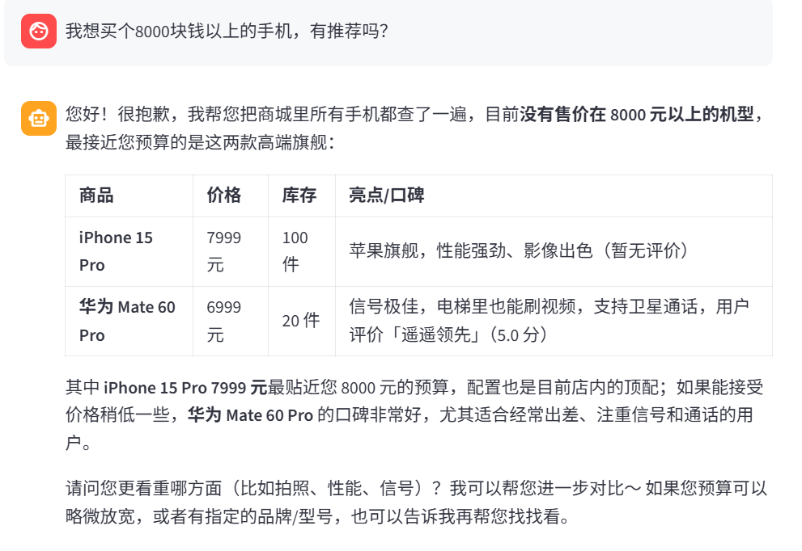
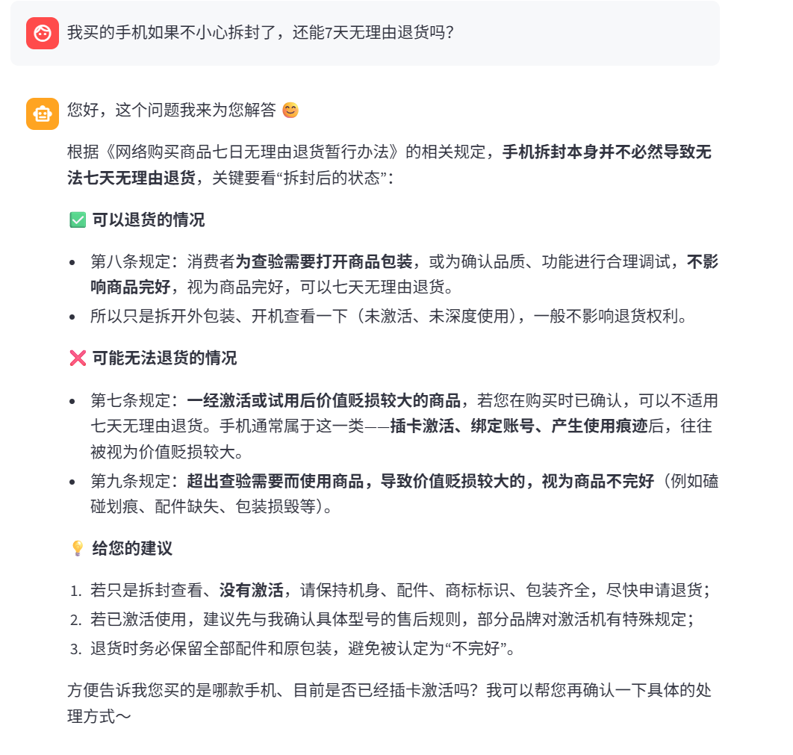
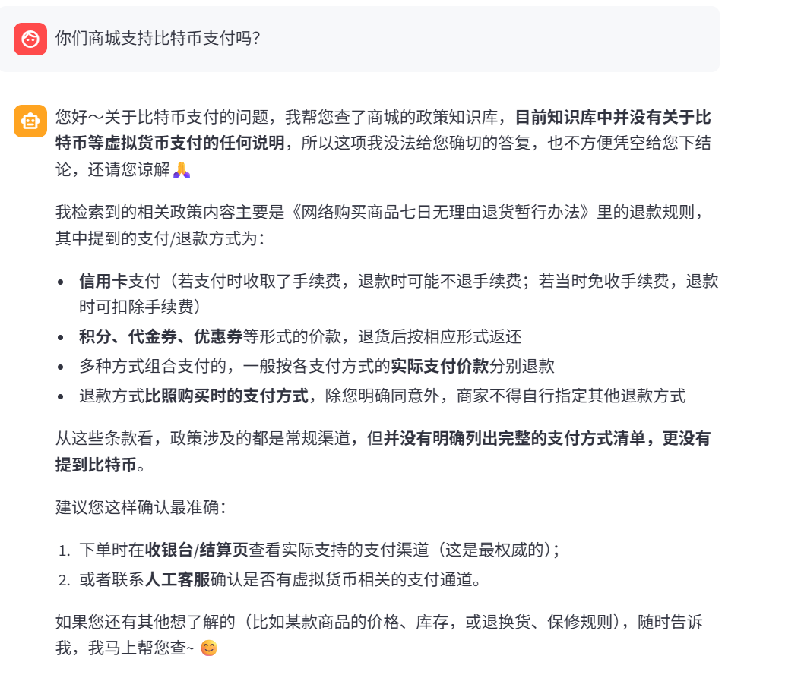

# 🛍️ SmartShop-AI (Agentic RAG E-commerce Backend)

**开箱即用的 AI 驱动电商业务中台。传统 CRUD 底座 + Agentic RAG 智能导购大脑。**

[](https://www.python.org/)
[](https://fastapi.tiangolo.com/)
[](https://python.langchain.com/)
[](https://opensource.org/licenses/MIT)

---

**English | 简体中文**

This is an AI-powered e-commerce backend boilerplate. It not only provides a robust RESTful API for traditional CRUD operations (Products & Reviews) but also integrates a LangChain Agent and Chroma vector database to deliver a smart shopping assistant with Tool Calling and RAG capabilities, completely eliminating LLM hallucinations in business rule Q&A.

---

## 📖 项目简介

`SmartShop-AI` 是一个全栈的、面向 AI 应用开发的电商后端模板。它解决了传统电商后台与大模型能力割裂的问题，通过 **Agentic RAG（智能体检索增强）** 架构，让大模型真正“长出了手”。

* 面对**业务数据**（查库存、看评价），Agent 会自主调用底层工具查询 SQLite 数据库。
* 面对**规则数据**（退换货政策），Agent 会强制检索 Chroma 向量库，绝不凭空捏造。

## ✨ 核心特性

### 1. 坚实的后端底座 (Traditional Backend)

* **FastAPI + SQLModel**：完整实现商品 (Product) 与评价 (Review) 模块的 CRUD 增删改查。
* **RESTful 规范**：标准的状态码 (400/404)、依赖注入 (`Depends`) 管理数据库 Session，保障连接池安全。
* **自动化文档**：内置 Swagger UI (`/docs`)，前后端联调极速体验。

### 2. 智能导购 Agent (Agentic AI)

* **Multi-Tool Calling**：大模型自主识别用户意图，智能调用“搜索商品”、“查询库存”、“获取口碑”三个核心工具。
* **多步推理**：能够结合用户预算，查库后综合口碑，给出极具人情味的导购建议。

### 3. 零幻觉知识库 (Zero-Hallucination RAG)

* **向量检索**：将复杂的电商退换货政策、法律条款抓取并切分存入 `Chroma`。
* **严格边界控制**：通过 Prompt 强约束，当用户问“支持比特币吗？”时，模型会诚实拒答，绝不瞎编。

### 4. 可视化全栈闭环 (Frontend)

* 内置基于 **Streamlit** 的极简聊天界面，一键启动，直连 FastAPI 接口，演示效果拉满。

---

## 📸 项目演示 (Demo)

*(注：请确保项目根目录下有 `screenshots` 文件夹，并放入对应的截图)*

### 1. 智能业务导购 (查库 + 查评价)

根据用户 8000 元预算，调用工具查询数据库，并综合真实用户口碑给出推荐。


### 2. 精准 RAG 规则解读

针对“手机拆封能否退货”的刁钻问题，RAG 准确检索政策条款，区分“拆封”与“激活”的边界。


### 3. 零幻觉测试 (防瞎编)

面对知识库中根本不存在的“比特币支付”问题，模型依据系统提示，坦诚拒答并给出安全建议。


---

## 🏗️ 系统架构 (Architecture)

```text
[用户] 💬 
  │
  ▼
[Streamlit UI] (前端)
  │  HTTP POST
  ▼
[FastAPI Router] (后端)
  │
  ├───> 传统 CRUD 接口 ──────> [SQLite Database] (商品/评价)
  │
  └───> Agent 接口 
          │
          ▼
     [LangChain Agent] (DeepSeek 大模型)
          │
          ├── Tool: search_products() ──> [SQLite Database]
          ├── Tool: check_stock() ──────> [SQLite Database]
          └── Tool: search_policy() ────> [Chroma Vector DB] (退换货规则)
```

---

## 🚀 快速开始 (Quick Start)

### 1. 克隆项目并安装依赖

```bash
git clone https://github.com/your-username/smartshop-ai.git
cd smartshop-ai
python -m venv .venv
# Windows 使用 .venv\Scripts\activate
source .venv/bin/activate  
pip install -r requirements.txt
```

### 2. 配置环境变量

在根目录创建 `.env` 文件，填入你的 API Keys：

```env
DEEPSEEK_API_KEY=your_deepseek_key
DEEPSEEK_BASE_URL=https://api.deepseek.com/v1
DASHSCOPE_API_KEY=your_dashscope_key
```

### 3. 初始化数据

一键插入 20 条精美的商品模拟数据：

```bash
python seed_data.py
```

*(首次启动时会自动抓取网页并构建 Chroma 向量知识库)*

### 4. 启动服务

**启动后端 API (FastAPI)**:

```bash
uvicorn main:app --reload
```

👉 访问 Swagger 接口文档: `http://127.0.0.1:8000/docs`

**启动前端 UI (Streamlit)**:

```bash
streamlit run demo/app.py
```

👉 访问智能导购对话界面: `http://localhost:8501`

---

## 📄 核心接口 (API Endpoints)

| 方法     | 路径             | 描述                          |
|:-------- |:---------------- |:----------------------------- |
| `POST`   | `/chat`          | AI 智能导购对话接口           |
| `GET`    | `/products`      | 获取商品列表 (支持过滤和分页) |
| `POST`   | `/products`      | 创建新商品                    |
| `GET`    | `/products/{id}` | 获取单个商品详情              |
| `DELETE` | `/products/{id}` | 删除商品                      |
| `POST`   | `/reviews`       | 为商品添加评价                |

---

## 🤝 贡献与协议 (Contribution & License)

本项目基于 **MIT License** 开源。如果您有任何优化建议或发现 Bug，欢迎提交 Pull Request 或 Issue！
